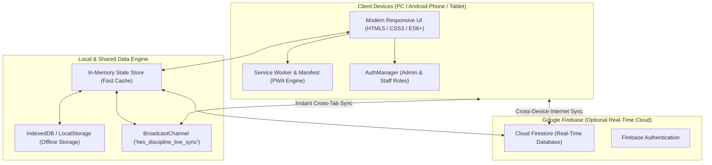

# 📋 School Discipline & Violation Record Tracker

[](https://github.com/muhammadkazim-maker/Violation-record)
[](https://firebase.google.com/)
[](https://github.com/muhammadkazim-maker/Violation-record)
[](https://github.com/muhammadkazim-maker/Violation-record)
[](https://github.com/muhammadkazim-maker/Violation-record)
[](LICENSE)

> **A collaborative, real-time disciplinary management system and institutional issues resolution hub designed for schools, colleges, and educational institutes.**

---

## 🌟 Executive Summary

**School Discipline Tracker (Violation Record)** enables school principals, headmasters, teachers, and administrative staff to collaboratively track student disciplinary infractions, monitor behavioral trends, resolve campus-wide operational issues, and maintain comprehensive student disciplinary dossiers.

Built with a high-performance **mobile-first PWA architecture**, the application works smoothly on Android smartphones, tablets, and desktop PCs. It offers instantaneous **0ms local sync via BroadcastChannel** and **global multi-device cloud synchronization with Google Cloud Firestore**, backed by an offline-first **IndexedDB storage engine** and **Service Worker caching**.

---

## 📑 Table of Contents

- [Key Features](#-key-features)
- [System Architecture](#-system-architecture)
- [Module Deep Dive](#-module-deep-dive)
  - [1. Add Violation Module](#1-add-violation-modal)
  - [2. Institutional Issues Hub & Collective Efforts](#2-institutional-issues-hub--collective-efforts)
  - [3. Records Master Sheet & Student Dossier](#3-records-master-sheet--student-dossier)
  - [4. Role-Based Authentication & Staff Switcher](#4-role-based-authentication--staff-switcher)
- [Severity Weighting Algorithm](#-severity-weighting-algorithm)
- [Quick Start (Local Running)](#-quick-start-local-running)
- [Deployment Guide](#-deployment-guide)
  - [Deploy to GitHub Pages](#option-1-github-pages-free--automated)
  - [Deploy to Vercel](#option-2-vercel-instant-preview)
  - [Deploy to Netlify](#option-3-netlify-drag--drop)
- [Firebase Cloud Sync Configuration](#-firebase-cloud-sync-configuration)
- [Android PWA Installation](#-android-pwa-installation)
- [Project Structure](#-project-structure)
- [Pre-configured Staff Accounts](#-pre-configured-staff-accounts)
- [Urdu / RTL Support (اردو رہنمائی)](#-urdu--rtl-support-اردو-رہنمائی)
- [License](#-license)

---

## ✨ Key Features

- **⚡ Real-Time Multi-User Collaboration**: When a teacher records a violation or adds an effort on their mobile phone, other teachers and the principal see updates instantly on their screens without refreshing.
- **📱 Mobile-First Responsive UI**: Fast touch-friendly buttons (minimum 44px touch targets), zero tap delay (`touch-action: manipulation`), bottom sticky navigation on mobile, and flexible desktop grid.
- **📶 100% Offline Resilience (PWA)**: Full offline functionality via Service Worker caching (`discipline-sw.js`) and persistent `IndexedDB`. Records made offline automatically synchronize when connectivity is restored.
- **🚨 5-Tier Severity Scoring**: Low, Medium, High, Extreme, and Ultra severity levels dynamically update each student's weighted disciplinary progress meter.
- **💡 Institutional Issues & Collective Resolution**: Replaces static observations with an actionable problem-solving tracker (e.g., campus cleanliness, punctuality) featuring multi-teacher collaborative effort timelines and creator-governed resolution.
- **📄 Student Profile Dossiers & PDF Reports**: Generate official, printable student conduct dossiers with detailed historical timelines, recorded staff signatures, and printable reports.
- **🔍 300ms Debounced Global Search**: Instantly filter across student names, roll numbers, classes, and issue titles without UI stutter.
- **📊 Export & Backup Options**: 1-click Export to Excel/CSV, student CSV import, and complete JSON database backup and restore.
- **🌙 Light & Dark Mode**: Seamless visual toggle with auto-preference persistence in localStorage.
- **🌐 Full Urdu (اردو) Unicode Support**: Native RTL text rendering (`dir="auto"`) in violation descriptions and issue notes.

---

## 🏗️ System Architecture



---

## 🔍 Module Deep Dive

### 1. Add Violation Modal
- **Quick Searchable Dropdown**: Select existing students or tap **"+ Add New Student"** directly within the workflow.
- **Automatic Class Binding**: Selecting a student auto-fills their class and section.
- **5-Button Single-Select Severity Tier**:
  | Severity | Color Theme | Weight | Impact Description |
  | :--- | :--- | :---: | :--- |
  | **Low** | 🟢 Emerald Green | `1x` | Minor infractions (uniform, talking in class) |
  | **Medium** | 🟡 Amber Yellow | `2x` | Homework neglect, repeated class disruptions |
  | **High** | 🟠 Bright Orange | `4x` | Disrespect, unexcused absence, skipping class |
  | **Extreme** | 🔴 Crimson Red | `7x` | Fighting, vandalism, exam misconduct |
  | **Ultra** | 🟣 Deep Ruby/Purple | `12x` | Severe safety violations, physical altercation |
- **Zero Manual Timestamps**: The system automatically captures and saves the exact timestamp (`Date.now()`) and logged-in teacher's identity.

### 2. Institutional Issues Hub & Collective Efforts
A collective problem-solving forum where faculty and management tackle school-wide operational and behavioral challenges:
- **Status Filtering Tabs**: Instant toggle between `All Issues`, `🔴 Unsolved`, and `🟢 Solved` with live dynamic count badges.
- **Efforts Timeline**: Any faculty member can contribute steps taken to resolve the issue (e.g., *"Inspected water filters at 10:30 AM"*, *"Called parents of recurrent latecomers"*).
- **Attribution & Rights**: Each effort shows the staff member's avatar, name, and timestamp. Members can edit or delete their own efforts; Admins can govern all entries.
- **Controlled Resolution**: Only the member who created the issue (or an Administrator) can mark it as **Solved**, complete with a confirmation dialog and reopen capability.

### 3. Records Master Sheet & Student Dossier
- **Unified Master Table**: Lists all students sorted by cumulative violations or weighted severity score.
- **Severity Progress Bar**: Visual meter running from Green (0%) to Red (100%) showing real-time disciplinary risk.
- **Student Profile Dossier**: Clicking any student row opens their comprehensive dossier containing:
  - Personal details, class, roll number.
  - Overall disciplinary meter and risk classification.
  - Complete chronological history of all infractions with staff attribution and timestamps.
  - **Print Official Report**: 1-click generation of a print-ready PDF conduct report formatted for parent-teacher conferences.

### 4. Role-Based Authentication & Staff Switcher
- **Active Member Profile Chip**: Prominently displayed in the header with avatar, name, and role badge.
- **Role Hierarchy**:
  - `admin`: Has unrestricted governance — can manage students, delete any records or efforts, mark any issue solved, and manage staff members.
  - `member`: Regular staff/teachers — can record violations, report institutional issues, add collaborative efforts, and edit/delete their own submissions.
- **Instant Switcher**: Allows quick profile switching during team meetings or shared device usage without entering credentials every time.

---

## 🧮 Severity Weighting Algorithm

The application computes each student's disciplinary status using a weighted composite formula:

$$\text{Severity Score} = \sum (\text{Count}_{\text{Low}} \times 1) + (\text{Count}_{\text{Med}} \times 2) + (\text{Count}_{\text{High}} \times 4) + (\text{Count}_{\text{Ext}} \times 7) + (\text{Count}_{\text{Ultra}} \times 12)$$

$$\text{Progress Meter Percentage} = \min\left(100, \left(\frac{\text{Severity Score}}{40}\right) \times 100\right)\%$$

- **0% – 30%**: 🟢 **Normal / Low Risk** (Green)
- **31% – 60%**: 🟡 **Moderate Attention Required** (Yellow/Orange)
- **61% – 85%**: 🔴 **High Disciplinary Risk** (Red)
- **86% – 100%**: 🟣 **Critical Behavioral Alert** (Dark Purple / Flashing)

---

## 🚀 Quick Start (Local Running)

### Prerequisites
Any standard computer with Python 3, Node.js, or simply a modern web browser (Chrome, Edge, Firefox, Safari).

### Method 1: Using Python (Recommended)
```bash
# Clone the repository
git clone https://github.com/muhammadkazim-maker/Violation-record.git
cd Violation-record

# Start the built-in development server
python server.py 3000
# or: python -m http.server 3000
```
Open your browser and navigate to: **`http://localhost:3000`**

### Method 2: Using Node.js
```bash
npx serve . -p 3000
```

### Method 3: Direct File Opening
Double-click `index.html` to open directly in Google Chrome or Microsoft Edge. (Note: Service Worker and PWA install prompts require an `http://` or `https://` origin).

---

## 🌐 Deployment Guide

### Option 1: GitHub Pages (Free & Automated)
1. In your GitHub repository (`muhammadkazim-maker/Violation-record`), click on **Settings**.
2. In the left navigation, click **Pages**.
3. Under **Build and deployment** -> **Source**, select `Deploy from a branch`.
4. Under **Branch**, select `main` and folder `/ (root)`.
5. Click **Save**.
6. Within 1-2 minutes, your live site will be accessible at:
   `https://muhammadkazim-maker.github.io/Violation-record/`

### Option 2: Vercel (Instant Preview)
```bash
# Install Vercel CLI
npm install -g vercel

# Deploy in project directory
cd Violation-record
vercel --prod
```

### Option 3: Netlify (Drag & Drop)
1. Visit [Netlify Drop](https://app.netlify.com/drop).
2. Drag and drop the `Violation-record` folder onto the page.
3. Your secure HTTPS URL is live instantly!

---

## ☁️ Firebase Cloud Sync Configuration

By default, the application runs with high-performance **Local Multi-Tab Broadcast Sync**. To enable real-time synchronization across different devices over the internet via Google Cloud Firestore:

1. Go to the [Firebase Console](https://console.firebase.google.com/) and click **Add project**.
2. Name your project (e.g., `hes-discipline-tracker`) and create it.
3. In your project dashboard, click the **Web icon (`</>`)** to register a web app.
4. Copy the `firebaseConfig` object:
   ```javascript
   const firebaseConfig = {
     apiKey: "AIzaSy...",
     authDomain: "hes-discipline.firebaseapp.com",
     projectId: "hes-discipline",
     storageBucket: "hes-discipline.appspot.com",
     messagingSenderId: "...",
     appId: "..."
   };
   ```
5. In the Firebase left sidebar, click **Build** -> **Firestore Database** -> **Create database**.
6. Choose **Start in test mode** (allows read/write during setup) and select a region close to your users.
7. Open the School Discipline Tracker in your browser, tap the **Firebase Setup** button in the top sync bar, paste your configuration JSON, and click **Save & Connect**.
8. All connected phones and PCs will now share live data in real-time!

---

## 📱 Android PWA Installation

The application is engineered as an installable Progressive Web Application (PWA):

1. Open your live application URL (or local network IP `http://192.168.x.x:3000`) in **Google Chrome** on your Android smartphone.
2. An **"Add School Discipline Tracker to Home screen"** prompt will appear automatically at the bottom.
3. Alternatively, tap the **three dots menu (⋮)** in Chrome and select **"Install app"** or **"Add to Home screen"**.
4. The application installs directly onto your phone's app drawer with its native logo.
5. Launches full-screen without URL bars, operates offline, and responds instantly to touch gestures.

---

## 👥 Administrator & Staff Accounts

| Full Name | Role | Username | Default Password | Permissions |
| :--- | :---: | :---: | :---: | :--- |
| **Administrator** | `Admin` | `admin` | `admin123` | Full access, manage staff, delete records, resolve issues |

*(New staff members and teachers can be added anytime through the Staff Switcher modal).*

---

## 📁 Project Structure

```
Violation-record/
├── index.html                   # Primary Web Application Entry Point
├── discipline.html              # Dedicated Application Route & Alias
├── issues.html                  # Standalone Collaborative Issues Hub
├── discipline-manifest.json     # PWA Web App Manifest (Name, Icons, Theme)
├── manifest.json                # Standard PWA Manifest Alias
├── discipline-sw.js             # Service Worker (Network-First Cache & Offline)
├── sw.js                        # Standard Service Worker Alias
├── server.py                    # Lightweight Python Development Server
├── .gitignore                   # Git Ignore Configuration
├── README.md                    # Comprehensive System Documentation
└── assets/
    ├── css/
    │   └── discipline.css       # Unified Responsive Stylesheet & Design System
    ├── js/
    │   ├── discipline-app.js    # Core State Management, Master Sheet & Modals
    │   ├── discipline-auth.js   # Authentication, Staff Switcher & Session State
    │   └── firebase-config.js   # Cloud Firestore & BroadcastChannel Sync Adapter
    └── images/
        └── logo.png             # Modern Application & PWA Icon (Balance & Shield)
```

---

## 🇵🇰 Urdu / RTL Support (اردو رہنمائی)

یہ ایپلیکیشن تعلیمی اداروں اور سکولوں میں طلبہ کے نظم و ضبط (Discipline) اور ادارہ جاتی مسائل کو باہمی تعاون سے حل کرنے کے لیے بنائی گئی ہے۔

### اہم خصوصیات:
1. **خلاف ورزی کا اندراج (Add Violation)**: طلبہ کی غلطیوں اور غیر سنجیدہ رویے کا فوری اندراج خودکار تاریخ اور وقت کے ساتھ۔
2. **5 درجاتی شدت (Severity)**: کم (Low)، درمیانہ (Medium)، زیادہ (High)، انتہائی (Extreme)، اور الٹرا (Ultra) کے رنگین بٹن۔
3. **مسائل اور مشترکہ کوششیں (Issues & Efforts)**: ادارے کے مسائل درج کریں اور تمام اساتذہ مل کر ان کے حل کے لیے کوششیں (Efforts) شامل کریں۔
4. **ماسٹر شیٹ اور طلبہ کی پروفائل (Master Sheet & Dossier)**: تمام طلبہ کا ریکارڈ، ڈسپلن میٹر، اور پرنٹ کے لیے تیار تفصیلی رپورٹ۔
5. **موبائل ایپ (PWA)**: اینڈرائیڈ موبائل پر باآسانی انسٹال ہو جاتی ہے اور انٹرنیٹ کے بغیر بھی آف لائن کام کرتی ہے۔
6. **اردو ٹیکسٹ سپورٹ**: اردو نستعلیق اور عربی تحریر کے لیے مکمل سپورٹ۔

---

## 📄 License

This project is licensed under the **MIT License** — you are free to use, modify, and distribute it for private or institutional management.

---

Developed with ❤️ for educational institutions and behavioral tracking worldwide.
